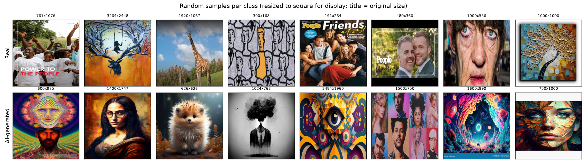
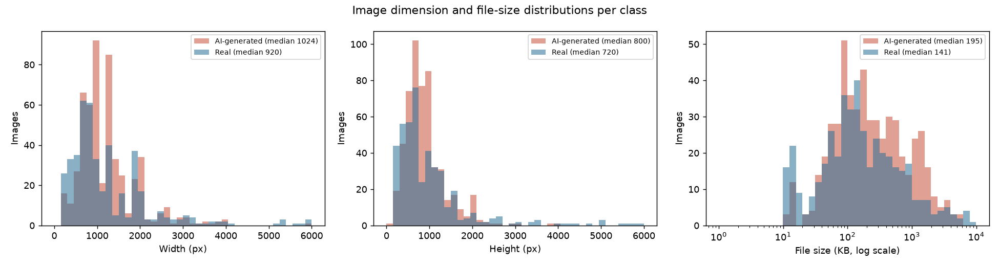
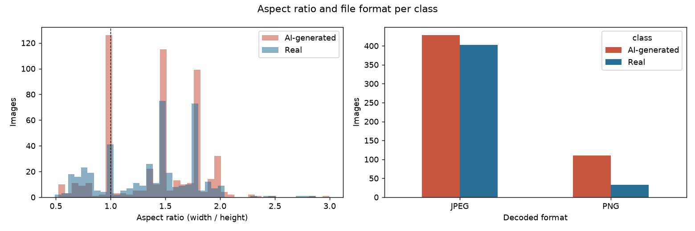

| | |
|---|---|
| **Name** | Ahsan Naeem |
| **Roll number** | 23L-0517 |
| **Project name** | 23L-0517_A2_Ops (GitHub, DagsHub, Oracle Cloud, Docker Compose project) |
| **GitHub** | https://github.com/ahsan24naeem/23L-0517_A2_Ops |
| **DagsHub** | https://dagshub.com/ahsan24naeem/23L-0517_A2_Ops |
| **MLflow (DagsHub)** | https://dagshub.com/ahsan24naeem/23L-0517_A2_Ops.mlflow |
| **Model API (Oracle Cloud)** | http://141.148.203.241:8000  (health: http://141.148.203.241:8000/health) |
| **Graded commit** | COMMIT_HASH |

**Disclosure of AI assistance.** I used Claude (Anthropic) as an AI assistant throughout this assignment: it wrote most of the code (data audit, tf.data pipeline, models, MLflow instrumentation, Flask app, model API, Dockerfiles, Compose, CI), ran the training experiments in a cloud workspace, and drafted this report. I supplied the dataset, ran every step that needed my accounts or my machine (GitHub, DagsHub, Docker Desktop, Oracle Cloud, Postman), took all screenshots, checked the results and edited the text. No other tutorials were followed beyond the official documentation of TensorFlow/Keras, MLflow, DVC, DagsHub, Docker and Oracle Cloud.

**How to read this report.** Each chapter matches one task; each sub-section is a sub-task ID. Under each one I explain what I did, why, how it works and what went wrong. Grey boxes marked *Screenshot* are the evidence captured on my own machine (terminal prompt `ahsannaeem@…`, date and project name visible).

**System overview.**

```
 Browser ──► Flask web app (localhost / Docker Compose) ──► PostgreSQL (history, named volume)
                     │  INFERENCE_MODE=local: loads champion.keras once
                     │  INFERENCE_MODE=remote: HTTPS/HTTP + X-API-Key
                     ▼
              Model API on Oracle Cloud VM (Gunicorn + TensorFlow CPU, champion.keras mounted)
 Training: Kaggle data ─DVC─► DagsHub storage │ tf.data ► Keras ► MLflow (DagsHub) ► Model Registry @champion
```

# Task 1 — Data Understanding and Versioning

## 1.1 Environment

**What and why.** I created an isolated Python 3.11 virtual environment so the project's library versions cannot clash with anything else installed, and pinned exact versions in `requirements.txt` so anyone (and the Docker image, and CI) installs the same thing. Python 3.11 was chosen because every library in the stack (TensorFlow 2.19, MLflow 2.22, DVC 3.59) supports it.

```bash
python3.11 -m venv .venv && source .venv/bin/activate
pip install -r requirements.txt
python scripts/check_env.py      # prints versions and whether TensorFlow sees a GPU
```

| Library | Version | Library | Version |
|---|---|---|---|
| Python | 3.11 | MLflow | 2.22.1 |
| TensorFlow (CPU) | 2.19.0 | DVC | 3.59.1 |
| Keras | 3.15.1 | NumPy / pandas | 2.1.3 / 2.3.3 |
| Keras Tuner | 1.4.7 | Pillow | 13.0.0 |
| scikit-learn | 1.9.1 | Flask / Gunicorn | 3.1.3 / 23.0.0 |

**GPU.** `tf.config.list_physical_devices("GPU")` returns an empty list: TensorFlow sees only the CPU, so all training ran on CPU. `requirements.txt` uses environment markers: `tensorflow-cpu` on x86-64 Linux (no CUDA libraries, much smaller) and the regular `tensorflow` wheel on macOS/ARM, where it is CPU-only anyway.

**What went wrong.** (1) The newest `pathspec` release broke `dvc add` (`cannot import name '_DIR_MARK'`), so I pinned `pathspec==0.12.1`. (2) SQLAlchemy 2.1 removed a class MLflow 2.22 imports (`FallbackAsyncAdaptedQueuePool`); I pinned SQLAlchemy 2.0.44. Both are typical "unpinned transitive dependency" failures, which is exactly why the versions are now pinned.

> **Screenshot 1.1** — Terminal on my Mac: `source .venv/bin/activate && python scripts/check_env.py` showing user@host, date, all versions and "GPU available: False".

## 1.2 Dataset audit

**What.** `scripts/audit_dataset.py` walks `data/raw/<class>/`, opens every file with Pillow and records class, path, extension, file size, width, height, colour mode, decoded format, a SHA-256 content hash and whether the file fully decodes (`im.load()` catches truncated files, not just bad headers). Exact duplicates are files with the same SHA-256. Output: `reports/audit.csv` (one row per image) and `reports/audit_summary.md`.

**Why.** Before training, I need to know whether files are readable, whether duplicates could leak between train and test, and whether the two classes differ in trivial ways (size, format) that a model could exploit instead of learning what "AI-generated" looks like.

Table 1.1 — Files per class

| Class | Files | Readable | Corrupt | Duplicate copies |
|---|---|---|---|---|
| AI-generated (`AiArtData`) | 539 | 539 | 0 | 1 |
| Real (`RealArt`) | 436 | 436 | 0 | 0 |
| **Total** | **975** | **975** | **0** | **1** |

Table 1.2 — Image dimensions and file size (min / median / max)

| Class | Width (px) | Height (px) | File size (KB) |
|---|---|---|---|
| AI-generated | 225 / 1024 / 6000 | 135 / 800 / 4001 | 11.5 / 195.1 / 5494.3 |
| Real | 183 / 920 / 8495 | 158 / 720 / 7091 | 11.0 / 141.4 / 9956.4 |

Table 1.3 — Decoded format and colour mode

| Class | JPEG | PNG | RGB | RGBA | P (palette) | L (grey) |
|---|---|---|---|---|---|---|
| AI-generated | 429 | 110 | 489 | 35 | 14 | 1 |
| Real | 403 | 33 | 407 | 14 | 9 | 6 |

**Findings.**

- **Corrupt files: 0.** Every file decodes completely.
- **Exact duplicates: 1 group** — `AiArtData/image33.jpg` and `image34.jpg` are byte-identical. No duplicate spans both classes. The second copy is dropped before splitting so the same picture cannot be in train and test.
- **Extensions lie.** The file extension does not always match the content: 9 `.png` files are really JPEG, 4 `.jpg` are PNG, the 3 `.webp` and 1 `.gif` files are JPEG, and one file has no extension at all. This is why the audit records the *decoded* format, and why the serving code validates by decoding, never by extension alone.
- **Format imbalance.** 20 % of AI images are PNG versus 8 % of real images. A PNG has no JPEG compression artefacts, so a model could partly learn "no JPEG blocking ⇒ AI" — a shortcut, not real understanding. I keep this in mind in the error analysis.
- **Hidden files.** Two genuine images have names starting with a dot (`.amazonaws.com2F…png`). My first version skipped all dot-files and counted 973 images; DVC counted 975. I changed the filter to skip only `.DS_Store` and `._*` macOS metadata.

> **Screenshot 1.2** — Terminal: `python scripts/audit_dataset.py` printing the summary tables.

## 1.3 Visual EDA

{width=100%}

*Interpretation.* AI-generated images are dominated by saturated, highly detailed fantasy and psychedelic art, smooth "perfect" portraits and stock-like renders. The "Real" folder is not only photographs: it contains paintings (Mona Lisa), cartoons, magazine covers and at least one image that looks generated (a pink fantasy palace). So the real task is closer to "generated art vs everything else on the web", and some labels are noisy — this caps the accuracy any model can reach.

{width=100%}

*Interpretation.* Both classes span 135–8500 px, with medians near 1000×750 px, so every image must be resized to a fixed input size. AI images cluster at generator-typical widths (≈1024 and ≈1280 px) and are larger files (median 195 KB vs 141 KB) because more of them are PNG; real images have a long tail of very small thumbnails (<20 KB) and very large camera photos. Resolution and file size are not used as features, and because everything is resized to 224×224 the model cannot read them directly — but resampling a 6000-px photo versus a 300-px thumbnail leaves different blur, which is a possible weak shortcut.

{width=95%}

*Interpretation.* Most images are landscape (ratio 1.3–1.8) with a spike of squares at 1.0, which is more common for AI images (generators often output 1:1). Resizing to a square therefore distorts most images somewhat; the decision is discussed in 2.1. The format panel visualises the PNG imbalance from 1.2.

## 1.4 DVC (data version control)

**Toy part.** `labs/dvc_toy/run_dvc_toy.sh` does every step in a new empty folder and echoes each command so the output can be read top-to-bottom:

1. `git init` + `dvc init` — Git will version code and *pointer files*, DVC the data.
2. A 3-row `weather.csv` is tracked with `dvc add weather.csv`. DVC moves the content into its cache (`.dvc/cache`), writes the pointer `weather.csv.dvc` and adds `weather.csv` to `.gitignore`. I commit the pointer: *data v1*.
3. Two rows are appended, `dvc add` again, commit: *data v2*. `git diff` shows that only the md5 and size inside the pointer changed.
4. **Going back:** `git checkout HEAD~1 -- weather.csv.dvc` restores the old pointer and `dvc checkout` replaces the CSV with the cached v1 content (3 rows). Then the same two commands bring v2 back.
5. **Remote:** `dvc remote add -d origin https://dagshub.com/ahsan24naeem/23L-0517_A2_Ops-dvc-toy.dvc`; the user name and token go into `.dvc/config.local`, which is never committed.
6. `dvc push` uploads the content; I then delete both `weather.csv` *and* `.dvc/cache` and run `dvc pull` — the file comes back from DagsHub, proving the remote holds the data.

**Apply.** The 975-image dataset (≈504 MB) is tracked the same way: `dvc add data/raw` produced `data/raw.dvc` (`md5: 8f23d6dc9b06d363c3981642c50856c0.dir`, `nfiles: 975`), the remote points at the project's DagsHub storage, and `dvc push` uploaded the images. The md5 is also logged as the `dvc_data_version` tag on every MLflow run, so each model can be traced back to the exact data.

**What the pointer file holds.** A few lines of YAML: the md5 hash of the content (for a folder, the hash of a manifest listing every file's hash), the total size, the number of files and the path. It is tiny, human-readable and changes whenever the data changes, so Git history *is* the data history.

**Why large data does not belong in Git.** Git stores every version of every file forever and every clone downloads the whole history: 500 MB of images, re-committed after each change, would make the repository huge and slow for everyone, and GitHub rejects files over 100 MB. Git's line-based diffs and merges are also meaningless for binary images. DVC keeps the heavy bytes in object storage, deduplicated by hash, and lets Git version only the small pointer.

> **Screenshot 1.3** — Toy run: `git log --oneline` with the "data v1" and "data v2" commits and the pointer diff.
> **Screenshot 1.4** — Toy run: `dvc checkout` back to v1 (3 rows), then `rm -rf weather.csv .dvc/cache` → `dvc pull` restoring the file.
> **Screenshot 1.5** — DagsHub web page of the toy repository showing the commits and the DVC-tracked `weather.csv`.
> **Screenshot 1.6** — `cat data/raw.dvc` and `dvc push` for the real dataset; DagsHub project page showing the `data/raw` folder tracked by DVC.

**What went wrong.** `dvc add data/raw` first failed because my `.gitignore` already ignored `/data/raw` (DVC refuses to create a pointer for a Git-ignored path — it needs to manage that ignore entry itself). Removing the line fixed it.
