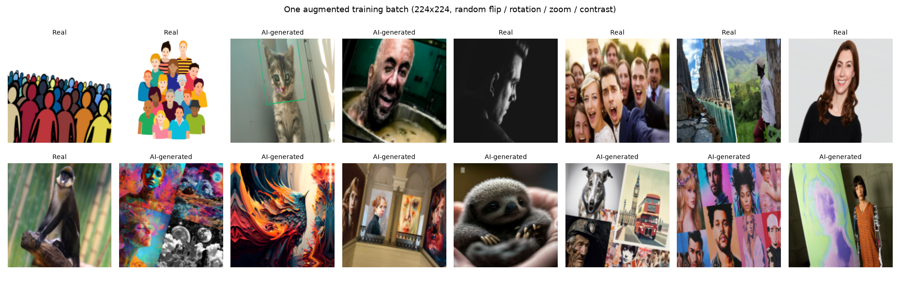
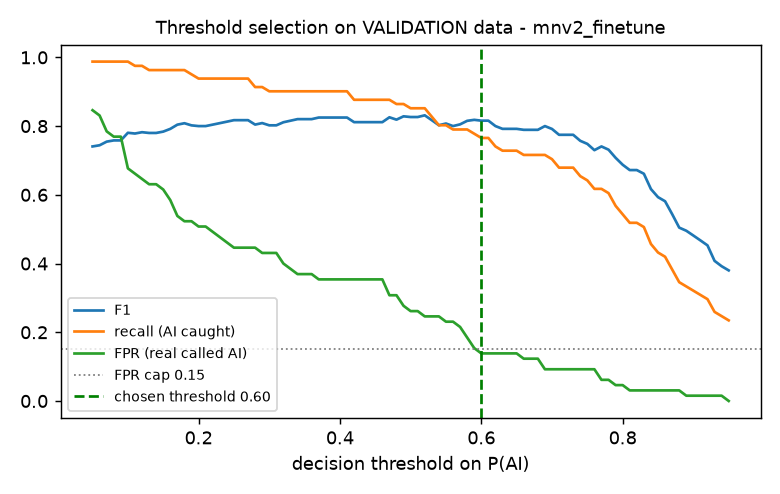
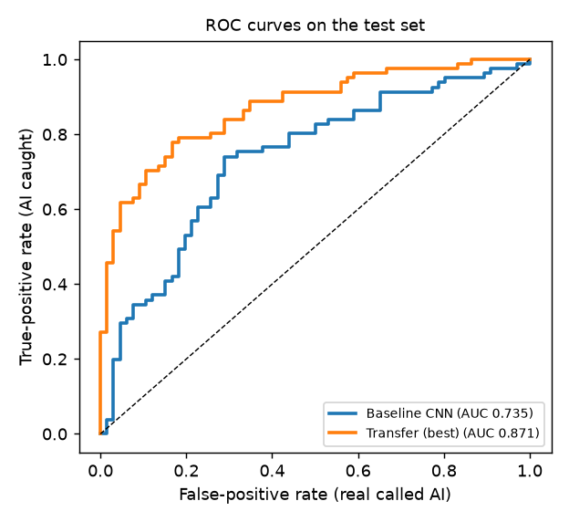
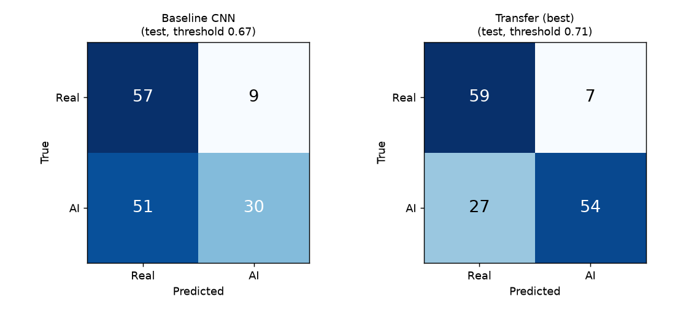
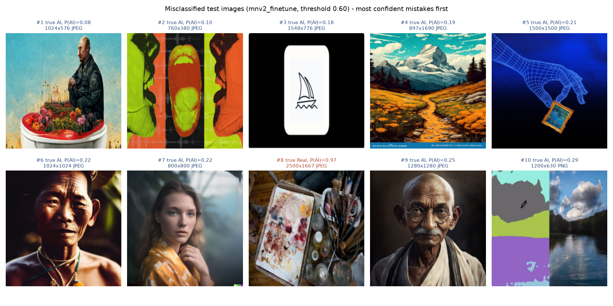
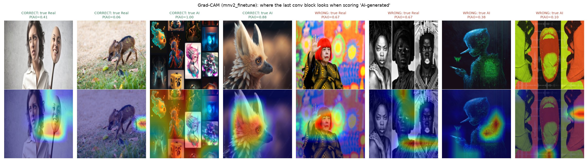

# Task 2 — Model Development with TensorFlow/Keras

**Splits.** `scripts/make_splits.py` drops corrupt files (none) and the duplicate copy, then makes a **stratified 70/15/15 split** with seed 42: train 681 (376 AI / 305 real), validation 146 (81 / 65), test 147 (81 / 66). The lists are saved as `splits/{train,val,test}.csv` (path, label, class, sha256), committed to Git and attached to every MLflow run, so every model sees exactly the same images. Validation is used for early stopping, threshold choice and model selection; **the test set is used once per model, after training, for the reported numbers.**

## 2.1 Input pipeline

`visionguard/data.py → make_dataset()` builds a `tf.data` pipeline from a split list:

1. **`from_tensor_slices((paths, labels))`** — a dataset of file paths and 0/1 labels (1 = AI-generated).
2. **`map(load, num_parallel_calls=AUTOTUNE)`** — decode + resize. It wraps `visionguard.preprocess.load_image` in `tf.numpy_function`: Pillow decodes the file (TensorFlow's own decoder cannot read the WEBP/odd files in this dataset), takes the first frame of animated images, applies EXIF rotation, converts every colour mode (L, P, RGBA) to **RGB**, and resizes to **224×224 with bilinear interpolation**, returning `uint8`. `ensure_shape` restores the static shape Keras needs.
3. **`cache(file)`** — decoded images are cached on disk per split and size. Decoding a 6000-px PNG is the slowest step; with the cache it happens once instead of every epoch (epoch time fell from ~33 s to ~13–20 s).
4. **`shuffle(len(train), reshuffle_each_iteration=True)`** — training only; a full buffer gives a true random order each epoch, seeded for reproducibility.
5. **`batch(32)`** and cast to float32.
6. **Augmentation — training data only** — a Keras `Sequential` of `RandomFlip("horizontal")`, `RandomRotation(±5 % of a turn ≈ ±18°)`, `RandomZoom(±10 %)` and `RandomContrast(±10 %)`, applied per batch. It enlarges the effective training set (681 images is tiny) without changing the label. I deliberately **did not** add blur, noise or JPEG re-compression: those would destroy the subtle high-frequency generator artefacts the model should learn. Validation and test data are never augmented, so their metrics measure the real images.
7. **`prefetch(AUTOTUNE)`** — prepares the next batch on the CPU while the model trains on the current one.

**Image size: 224×224** — the native resolution MobileNetV2's ImageNet weights were trained at, and a reasonable compromise on CPU. A 160-px variant is one of the experiments (3.5).

**Aspect ratio.** Images are **squashed** to a square, not cropped or padded. Most images are landscape (ratio ≈1.3–1.8), so objects get narrower, but the *whole* picture — including corners, borders and watermarks that can be informative — stays visible, and no padding bars (which differ between classes) are introduced. Because serving calls the identical function, the distortion is the same in training and production.

{width=95%}

## 2.2 Baseline CNN

Designed from scratch in `visionguard/models.py → build_baseline_cnn()`:

BASELINE_TABLE

Why each layer is there:

- **Rescaling(1/255)** — maps pixels to [0, 1] inside the model, so serving feeds raw pixels.
- **Four Conv(3×3, same) → BatchNorm → ReLU → MaxPool(2) blocks with 32→64→128→256 filters.** 3×3 convolutions learn local patterns (edges, textures, generator artefacts); stacking them grows the receptive field. Doubling filters while pooling halves the resolution keeps computation balanced and lets deeper layers represent more complex patterns. **BatchNorm** normalises activations so training is faster and less sensitive to the learning rate (bias is dropped from the conv because BN has its own shift). **ReLU** adds non-linearity. **MaxPooling** downsamples and gives small translation invariance.
- **GlobalAveragePooling** — one number per feature map; far fewer parameters than `Flatten` + Dense (which would have millions of weights and overfit 681 images).
- **Dropout(0.4)** — randomly zeroes 40 % of features during training to reduce overfitting.
- **Dense(1, sigmoid)** — one output = P(AI-generated).

**Loss, optimiser, metrics.** *Binary cross-entropy* is the correct likelihood loss for a single sigmoid output and gives calibrated probabilities. *Adam* (lr 1e-3) adapts the step size per weight and works well without tuning. Metrics: *accuracy* (easy to read), *ROC-AUC* (threshold-independent ranking quality — the main selection metric), *precision* and *recall* (the two error types matter differently here, see 2.5).

> **Screenshot 2.1** — `model.summary()` of the baseline CNN (text also in `reports/runs/cnn_baseline/model_summary.txt` and attached to the MLflow run).

## 2.3 Transfer learning (MobileNetV2)

`build_transfer_model("mobilenetv2")` loads `keras.applications.MobileNetV2(include_top=False, weights="imagenet")` — the ImageNet feature extractor without its 1000-class classifier — and adds my head: **GlobalAveragePooling → Dropout(0.3) → Dense(1, sigmoid)**.

**Preprocessing.** MobileNetV2 was trained on pixels scaled to **[-1, 1]** (`preprocess_input` = x/127.5 − 1). Feeding [0, 1] or [0, 255] would shift every activation away from what the pretrained filters expect and waste the pretraining. I implemented it as `Rescaling(1/127.5, offset=-1)` *inside* the model, so the saved model contains its own preprocessing. (For the ResNet50 experiment the model contains the Caffe-style preprocessing ResNet50 expects instead: RGB→BGR and ImageNet mean subtraction, no scaling.)

**Stage 1 — frozen backbone.** `base.trainable = False`; only the head trains (lr 1e-3, ≤15 epochs). The backbone is called with `training=False`, which keeps its BatchNorm layers in inference mode even later, so their ImageNet statistics are not overwritten by small batches.

**Stage 2 — fine-tune the last block.** I unfreeze only MobileNetV2's last block (`block_16_*` + the final `Conv_1` 1×1 convolution), keep all BatchNorm layers frozen, recompile with a **100× smaller learning rate (1e-5)** and train ≤15 more epochs. The small rate adapts high-level features to "AI vs real" without destroying what the pretrained weights know.

TRAINABLE_LAYERS

TRANSFER_CURVES

## 2.4 Training discipline

- **Seeds:** `keras.utils.set_random_seed(42)` seeds Python, NumPy and TensorFlow; the shuffle and augmentation layers also get seed 42; the split uses `random_state=42`. (CPU training is then repeatable up to small floating-point differences from multi-threading.)
- **EarlyStopping(monitor=val_loss, patience=4, restore_best_weights=True)** — stops when validation loss has not improved for 4 epochs (6 for the CNN).
- **ModelCheckpoint(val_loss, save_best_only=True)** — keeps the single best model across both stages on disk; the final evaluation reloads it.
- **ReduceLROnPlateau(val_loss, factor=0.3, patience=2)** — cuts the learning rate when progress stalls.

BEST_EPOCHS

## 2.5 Evaluation

**Which error is worse?** For VisionGuard, **calling a real photo fake (false positive)** is worse. The product will be used to judge journalism, evidence, art submissions and personal photos; a false "AI-generated" verdict publicly accuses an honest person of fabrication and can damage reputations, while missing a fake (false negative) leaves the situation as it would have been without the tool. Users can also apply other checks to a suspicious image, but a false accusation is hard to undo.

**Threshold choice — on validation data.** For each threshold from 0.05 to 0.95 I compute F1 and the false-positive rate (real called AI) on the *validation* set and pick the threshold with the **highest F1 subject to FPR ≤ 15 %**. The cap encodes the product decision above; F1 then balances precision and recall within it. Choosing the threshold on the test set would leak test information into the model and overstate performance.

{width=80%}

FINAL_METRICS

{width=62%}

{width=85%}

EVAL_DISCUSSION

## 2.6 Error analysis

{width=100%}

ERROR_TABLE

## 2.7 Tool lab: Keras Tuner

**Toy part.** `labs/keras_tuner_toy.py` tunes a one-hidden-layer network on **Fashion-MNIST** with **Hyperband** (max 6 epochs, factor 3), searching `units ∈ {32…256}` and `learning_rate ∈ [1e-4, 1e-2]` (log scale), objective validation accuracy. Hyperband trains many configurations for 2 epochs, promotes the best third to 6 epochs, etc., so bad settings are dropped cheaply.

TOY_TUNER

**Apply.** `scripts/tune.py` runs **RandomSearch with TUNER_TRIALS trials** on MobileNetV2 (224 px), searching learning rate ∈ [1e-5, 1e-3] (log), dropout ∈ {0.1 … 0.5} and **number of unfrozen backbone layers ∈ {0, 10, 20, 40}**. Each trial trains for up to 5 epochs with early stopping and is scored on validation AUC; the table is logged to MLflow (experiment `VisionGuard-tuning`).

TUNER_RESULTS

**Why choosing the best validation score can overfit the validation set.** Each trial's validation score is a noisy estimate (146 images: one image is 0.7 % accuracy). Trying many configurations and keeping the maximum selects partly for *luck on these particular 146 images* — the winner's score is optimistically biased, and the more trials, the stronger the bias ("winner's curse"). The validation set has effectively been used for fitting the hyper-parameters. That is why the final numbers are reported on the untouched test set, and why small differences between trials (±0.01 AUC) should not be over-interpreted; with more data, nested or k-fold cross-validation would give a more reliable choice.

## Bonus — Grad-CAM

{width=100%}

GRADCAM_DISCUSSION
