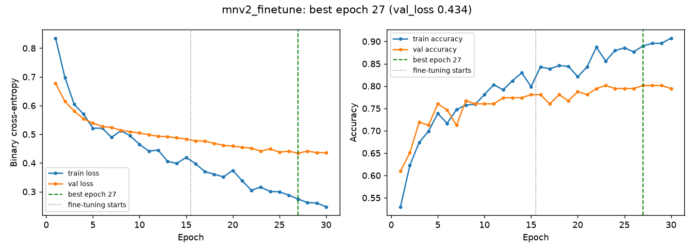
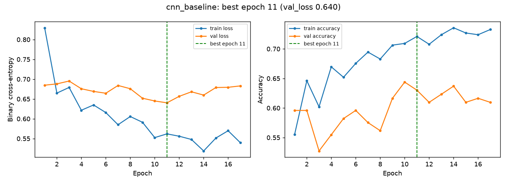

# Task 2 — Model Development with TensorFlow/Keras

**Splits.** `scripts/make_splits.py` drops corrupt files (none) and the duplicate copy, then makes a **stratified 70/15/15 split** with seed 42: train 681 (376 AI / 305 real), validation 146 (81 / 65), test 147 (81 / 66). The lists are saved as `splits/{train,val,test}.csv` (path, label, class, sha256), committed to Git and attached to every MLflow run, so every model sees exactly the same images. Validation is used for early stopping, threshold choice and model selection; **the test set is used once per model, after training, for the reported numbers.**

## 2.1 Input pipeline

`visionguard/data.py → make_dataset()` builds a `tf.data` pipeline from a split list:

1. **`from_tensor_slices((paths, labels))`** — a dataset of file paths and 0/1 labels (1 = AI-generated).
2. **`map(load, num_parallel_calls=AUTOTUNE)`** — decode + resize. It wraps `visionguard.preprocess.load_image` in `tf.numpy_function`: Pillow decodes the file (TensorFlow's own decoder cannot read the WEBP/odd files in this dataset), takes the first frame of animated images, applies EXIF rotation, converts every colour mode (L, P, RGBA) to **RGB**, and resizes to **224×224 with bilinear interpolation**, returning `uint8`. `ensure_shape` restores the static shape Keras needs.
3. **`cache(file)`** — decoded images are cached on disk per split and size. Decoding a 6000-px PNG is the slowest step; with the cache it happens once instead of every epoch (epoch time fell from ~33 s to ~13–20 s).
4. **`shuffle(len(train), reshuffle_each_iteration=True)`** — training only; a full buffer gives a true random order each epoch, seeded for reproducibility.
5. **`batch(32)`** and cast to float32.
6. **Augmentation — training data only** — a Keras `Sequential` of `RandomFlip("horizontal")`, `RandomRotation(±5 % of a turn ≈ ±18°)`, `RandomZoom(±10 %)` and `RandomContrast(±10 %)`, applied per batch. It enlarges the effective training set (681 images is tiny) without changing the label. I deliberately **did not** add blur, noise or JPEG re-compression: those would destroy the subtle high-frequency generator artefacts the model should learn. Validation and test data are never augmented, so their metrics measure the real images.
7. **`prefetch(AUTOTUNE)`** — prepares the next batch on the CPU while the model trains on the current one.

**Image size: 224×224** — the native resolution MobileNetV2's ImageNet weights were trained at, and a reasonable compromise on CPU. A 160-px variant is one of the experiments (3.5).

**Aspect ratio.** Images are **squashed** to a square, not cropped or padded. Most images are landscape (ratio ≈1.3–1.8), so objects get narrower, but the *whole* picture — including corners, borders and watermarks that can be informative — stays visible, and no padding bars (which differ between classes) are introduced. Because serving calls the identical function, the distortion is the same in training and production.

{width=95%}

## 2.2 Baseline CNN

Designed from scratch in `visionguard/models.py → build_baseline_cnn()`:

Table 2.1 — Baseline CNN, layer by layer (input 224×224×3)

| Layer | Output shape | Parameters |
|---|---|---|
| Input `image` | (224, 224, 3) | 0 |
| Rescaling 1/255 | (224, 224, 3) | 0 |
| Conv2D 32 × 3×3 → BatchNorm → ReLU | (224, 224, 32) | 864 + 128 |
| MaxPooling 2×2 | (112, 112, 32) | 0 |
| Conv2D 64 × 3×3 → BatchNorm → ReLU | (112, 112, 64) | 18,432 + 256 |
| MaxPooling 2×2 | (56, 56, 64) | 0 |
| Conv2D 128 × 3×3 → BatchNorm → ReLU | (56, 56, 128) | 73,728 + 512 |
| MaxPooling 2×2 | (28, 28, 128) | 0 |
| Conv2D 256 × 3×3 → BatchNorm → ReLU | (28, 28, 256) | 294,912 + 1,024 |
| MaxPooling 2×2 | (14, 14, 256) | 0 |
| GlobalAveragePooling2D | (256) | 0 |
| Dropout 0.4 | (256) | 0 |
| Dense 1, sigmoid | (1) | 257 |
| **Total** | | **390,113** (389,153 trainable; 960 BatchNorm moving statistics) |

Why each layer is there:

- **Rescaling(1/255)** — maps pixels to [0, 1] inside the model, so serving feeds raw pixels.
- **Four Conv(3×3, same) → BatchNorm → ReLU → MaxPool(2) blocks with 32→64→128→256 filters.** 3×3 convolutions learn local patterns (edges, textures, generator artefacts); stacking them grows the receptive field. Doubling filters while pooling halves the resolution keeps computation balanced and lets deeper layers represent more complex patterns. **BatchNorm** normalises activations so training is faster and less sensitive to the learning rate (bias is dropped from the conv because BN has its own shift). **ReLU** adds non-linearity. **MaxPooling** downsamples and gives small translation invariance.
- **GlobalAveragePooling** — one number per feature map; far fewer parameters than `Flatten` + Dense (which would have millions of weights and overfit 681 images).
- **Dropout(0.4)** — randomly zeroes 40 % of features during training to reduce overfitting.
- **Dense(1, sigmoid)** — one output = P(AI-generated).

**Loss, optimiser, metrics.** *Binary cross-entropy* is the correct likelihood loss for a single sigmoid output and gives calibrated probabilities. *Adam* (lr 1e-3) adapts the step size per weight and works well without tuning. Metrics: *accuracy* (easy to read), *ROC-AUC* (threshold-independent ranking quality — the main selection metric), *precision* and *recall* (the two error types matter differently here, see 2.5).

> **Screenshot 2.1** — `model.summary()` of the baseline CNN (text also in `reports/runs/cnn_baseline/model_summary.txt` and attached to the MLflow run).

## 2.3 Transfer learning (MobileNetV2)

`build_transfer_model("mobilenetv2")` loads `keras.applications.MobileNetV2(include_top=False, weights="imagenet")` — the ImageNet feature extractor without its 1000-class classifier — and adds my head: **GlobalAveragePooling → Dropout(0.3) → Dense(1, sigmoid)**.

**Preprocessing.** MobileNetV2 was trained on pixels scaled to **[-1, 1]** (`preprocess_input` = x/127.5 − 1). Feeding [0, 1] or [0, 255] would shift every activation away from what the pretrained filters expect and waste the pretraining. I implemented it as `Rescaling(1/127.5, offset=-1)` *inside* the model, so the saved model contains its own preprocessing. (For the ResNet50 experiment the model contains the Caffe-style preprocessing ResNet50 expects instead: RGB→BGR and ImageNet mean subtraction, no scaling.)

**Stage 1 — frozen backbone.** `base.trainable = False`; only the head trains (lr 1e-3, ≤15 epochs). The backbone is called with `training=False`, which keeps its BatchNorm layers in inference mode even later, so their ImageNet statistics are not overwritten by small batches.

**Stage 2 — fine-tune the last block.** I unfreeze only MobileNetV2's last block (`block_16_*` + the final `Conv_1` 1×1 convolution), keep all BatchNorm layers frozen, recompile with a **100× smaller learning rate (1e-5)** and train ≤15 more epochs. The small rate adapts high-level features to "AI vs real" without destroying what the pretrained weights know.

Table 2.2 — What is trainable in each stage (`reports/runs/mnv2_finetune/trainable_layers.json`)

| Stage | Trainable layers | Trainable parameters | Learning rate |
|---|---|---|---|
| 1 — frozen backbone | `p_ai` (Dense head) only | 1,281 | 1e-3 |
| 2 — fine-tune last block | `block_16_expand`, `block_16_depthwise`, `block_16_project`, `Conv_1` (+ head); BatchNorm layers stay frozen | 880,321 | 1e-5 |

The full model has 2.26 M weights; in stage 1 only 0.06 % of them learn, in stage 2 about 39 % (the last block and the final 1×1 convolution hold most of MobileNetV2's parameters). The `unfreeze40` experiment instead unfreezes from `block_13_*` onward (13 backbone layers with weights).

{width=100%}

{width=100%}

*Reading the curves.* In stage 1 validation loss falls steadily from 0.68 to 0.48 while only the head learns; it was still improving slowly at epoch 15. When the last block is unfrozen (epoch 16) training accuracy jumps from ~0.80 to ~0.85 and keeps climbing to 0.91, and validation loss continues down to **0.434** — fine-tuning helps, but the growing train/validation gap (0.91 vs 0.80 accuracy) shows the model starting to memorise 681 images, which is exactly why the learning rate is 100× smaller and early stopping/checkpointing watch validation loss. The CNN from scratch learns far more slowly: validation loss barely moves below 0.64, validation AUC stays around 0.68 and early stopping ends training after 17 epochs.

## 2.4 Training discipline

- **Seeds:** `keras.utils.set_random_seed(42)` seeds Python, NumPy and TensorFlow; the shuffle and augmentation layers also get seed 42; the split uses `random_state=42`. (CPU training is then repeatable up to small floating-point differences from multi-threading.)
- **EarlyStopping(monitor=val_loss, patience=4, restore_best_weights=True)** — stops when validation loss has not improved for 4 epochs (6 for the CNN).
- **ModelCheckpoint(val_loss, save_best_only=True)** — keeps the single best model across both stages on disk; the final evaluation reloads it.
- **ReduceLROnPlateau(val_loss, factor=0.3, patience=2)** — cuts the learning rate when progress stalls.

Table 2.3 — Best epoch (lowest validation loss, marked green in the curves)

| Run | Epochs trained | Best epoch | Note |
|---|---|---|---|
| Baseline CNN | 17 of 30 | **11** | early stopping (patience 6) |
| MobileNetV2 fine-tuned (chosen) | 15 + 15 | **27** (epoch 12 of fine-tuning) | reached the epoch limit; checkpoint keeps epoch 27 |
| MobileNetV2 head only | 15 | 15 | still improving — more epochs would help a little |
| **MobileNetV2 tuned (champion, 2.7)** | 15 + 15 | **27** (epoch 12 of fine-tuning) | val loss 0.406; checkpoint keeps epoch 27 |

`ReduceLROnPlateau` cut the CNN's learning rate from 1e-3 to 9e-5 by epoch 10, which is visible as the flattening of its curves.

## 2.5 Evaluation

**Which error is worse?** For VisionGuard, **calling a real photo fake (false positive)** is worse. The product will be used to judge journalism, evidence, art submissions and personal photos; a false "AI-generated" verdict publicly accuses an honest person of fabrication and can damage reputations, while missing a fake (false negative) leaves the situation as it would have been without the tool. Users can also apply other checks to a suspicious image, but a false accusation is hard to undo.

**Threshold choice — on validation data.** For each threshold from 0.05 to 0.95 I compute F1 and the false-positive rate (real called AI) on the *validation* set and pick the threshold with the **highest F1 subject to FPR ≤ 15 %**. The cap encodes the product decision above; F1 then balances precision and recall within it. Choosing the threshold on the test set would leak test information into the model and overstate performance.

{width=80%}

Table 2.4 — Test-set metrics (147 images, each model evaluated once, threshold chosen on validation)

| Model | Threshold | Accuracy | Precision | Recall | F1 | ROC-AUC | FPR real→AI | FNR AI→real |
|------------|---|---|---|---|---|---|---|---|
| Baseline CNN | 0.67 | 0.592 | 0.769 | 0.370 | 0.500 | 0.735 | 0.136 | 0.630 |
| MobileNetV2, last block fine-tuned (2.3) | 0.60 | 0.796 | 0.881 | 0.728 | 0.797 | 0.868 | 0.121 | 0.272 |
| **MobileNetV2 tuned — champion** | **0.71** | **0.769** | **0.885** | **0.667** | **0.761** | **0.871** | **0.106** | **0.333** |

Confusion counts (TN / FP / FN / TP): CNN 57 / 9 / 51 / 30; MobileNetV2 (2.3) 58 / 8 / 22 / 59; champion 59 / 7 / 27 / 54. The champion is the run with the best **validation** ROC-AUC (0.898) — see 3.5 for the selection.

{width=62%}

{width=85%}

*Interpretation.* Transfer learning wins clearly on every metric: ROC-AUC 0.87 vs 0.735 and F1 0.76–0.80 vs 0.50. With only 681 training images, a network trained from scratch cannot learn good visual features; MobileNetV2 brings features learned from 1.2 M ImageNet images and only has to learn how to combine them.

The champion's threshold is **0.71**, not 0.5: on validation (Figure 2.4), 0.5 would flag far more real images as AI; 0.71 is the F1-best threshold whose false-positive rate (7.7 % on validation) stays under the 15 % cap. On the test set it flagged **7 of 66 real images (FPR 10.6 %)** — the lowest of the three — while catching two thirds of AI images, with 88.5 % precision: when VisionGuard says "AI-generated" it is right almost 9 times in 10. This is the trade-off I chose deliberately: fewer false accusations at the cost of missing more fakes. The 2.3 model has a higher test F1 (0.797) at threshold 0.60, but it was *not* selected because model choice must not look at the test set; on 147 test images a difference of 0.03 F1 is about four images and within noise (its validation AUC was 0.881 vs 0.898). For the CNN the same rule forces a high threshold (0.67) and it then misses 63 % of AI images: a weak ranker cannot meet the constraint without giving up recall. The remaining false positives are why the result page carries a caveat.

## 2.6 Error analysis

{width=100%}

Table 2.5 — Hypotheses for the 10 most confident mistakes of the champion (all 10 are AI images called real; its 7 false positives are less confident)

| # | P(AI) | What the image is | Hypothesis |
|-|--|--------|------------|
| 1 | 0.03 | Vintage-print collage of a politician in a bathtub of flowers | Paper texture, grain and muted print colours imitate a scanned photo — no glossy "AI look" |
| 2 | 0.03 | Flat pop-art poster of lips | Graphic design with flat colour areas, like the posters/illustrations in the *Real* folder; no photographic texture to judge |
| 3 | 0.13 | Painted mountain landscape with a stock-site **watermark** | Watermark and illustration style resemble the stock images in the *Real* class |
| 4 | 0.15 | Photorealistic portrait of an elderly man | Highly photorealistic generator output; skin/hair artefacts disappear when 1024 px is **downsampled** to 224 px |
| 5 | 0.16 | App-icon-like sailboat logo on black | Not a generated scene but a logo/screenshot — effectively **label noise**; almost no texture |
| 6 | 0.17 | 3D wireframe hand holding a framed picture | Clean CGI render on a plain dark background; the model learned "busy, saturated detail ⇒ AI", which this lacks |
| 7 | 0.18 | Portrait of a young woman, shallow depth of field | Photorealistic like #4; the generator's coloured signature in the corner shrinks to a few pixels |
| 8 | 0.25 | Studio portrait of an elderly man with round glasses | Photorealistic portrait lighting, like #4 |
| 9 | 0.26 | Hybrid animal (boar with quills) in a dusty field | Plausible natural photo style with **blurred background**; the impossible anatomy is a semantic cue the model does not use |
| 10 | 0.32 | Flat vector illustration of mountains with map pins | **Vector/flat illustration** (PNG) — no texture at all; resembles clip-art in the *Real* folder |

**Pattern.** The mistakes are dominated by *photorealistic* AI images (4, 7, 8, 9) and by *non-photographic* AI images — posters, logos, CGI and vector art (2, 5, 6, 10). The model has largely learned a **style/texture** cue (saturated, over-detailed fantasy art ⇒ AI) rather than generator artefacts or semantic errors, which mirrors the dataset: most AI images are fantasy art, while the *Real* folder mixes photos with paintings and graphics. Downsampling to 224 px also removes fine high-frequency evidence. Size and format do not explain these errors — nine of ten are ordinary JPEGs of typical size. The same images were also the top mistakes of the 2.3 model, so this is a systematic data problem, not a quirk of one training run.

## 2.7 Tool lab: Keras Tuner

**Toy part.** `labs/keras_tuner_toy.py` tunes a one-hidden-layer network on **Fashion-MNIST** with **Hyperband** (max 6 epochs, factor 3), searching `units ∈ {32…256}` and `learning_rate ∈ [1e-4, 1e-2]` (log scale), objective validation accuracy. Hyperband trains many configurations for 2 epochs, promotes the best third to 6 epochs, etc., so bad settings are dropped cheaply.

Table 2.6 — Keras Tuner Hyperband on Fashion-MNIST (10 trials; trials 0–4 trained 2 epochs, the promoted ones 6)

| Trial | Units | Learning rate | Epochs | Val. accuracy |
|---|---|---|---|---|
| 7 | 256 | 0.00172 | 6 | **0.8775** |
| 5 | 256 | 0.00051 | 6 | 0.8748 |
| 6 | 128 | 0.00035 | 6 | 0.8563 |
| 9 | 256 | 0.00012 | 6 | 0.8519 |
| 8 | 256 | 0.00015 | 6 | 0.8505 |
| 2 | 256 | 0.00051 | 2 | 0.8435 |
| 1 | 128 | 0.00035 | 2 | 0.8339 |
| 4 | 128 | 0.00031 | 2 | 0.8247 |
| 3 | 160 | 0.00014 | 2 | 0.8167 |
| 0 | 192 | 0.00012 | 2 | 0.8158 |

Reading the best settings with `tuner.get_best_hyperparameters()[0]` gives **256 units and learning rate ≈ 1.7e-3**; the best model reaches **86.9 % test accuracy**. More units and a learning rate around 1e-3 help; very small learning rates (≈1e-4) are clearly worse within 6 epochs because the network has not converged.

**Apply.** `scripts/tune.py` runs **RandomSearch with 10 trials** on MobileNetV2 (224 px), searching learning rate ∈ [1e-5, 1e-3] (log), dropout ∈ {0.1 … 0.5} and **number of unfrozen backbone layers ∈ {0, 10, 20, 40}**. Each trial trains for up to 5 epochs with early stopping and is scored on validation AUC; the table is logged to MLflow (experiment `VisionGuard-tuning`).

Table 2.7 — VisionGuard random search, 10 trials, sorted by validation AUC

| Trial | Learning rate | Dropout | Unfrozen layers | Val. AUC |
|---|---|---|---|---|
| 07 | 7.8e-5 | 0.3 | 10 | **0.894** |
| 09 | 2.3e-4 | 0.5 | 10 | 0.893 |
| 02 | 1.2e-4 | 0.1 | 10 | 0.893 |
| 00 | 1.9e-4 | 0.1 | 10 | 0.892 |
| 03 | 3.1e-5 | 0.5 | 20 | 0.878 |
| 01 | 3.5e-5 | 0.5 | 10 | 0.869 |
| 06 | 4.1e-5 | 0.3 | 40 | 0.861 |
| 08 | 1.4e-5 | 0.1 | 20 | 0.840 |
| 04 | 6.7e-4 | 0.1 | 40 | 0.582 |
| 05 | 1.2e-5 | 0.3 | 0 | 0.446 |

{width=100%}

**Which setting mattered most: the learning rate.** It has the strongest rank correlation with validation AUC (ρ = +0.43, vs −0.27 for unfrozen layers and +0.22 for dropout), and both failures are learning-rate failures: 6.7e-4 with 40 unfrozen layers (AUC 0.58) is so large that it wrecks the pretrained features of many layers at once, and 1.2e-5 with a frozen backbone (0.45) is so small that the new head barely moves in 5 epochs. Between those extremes the number of unfrozen layers interacts with it — all four best trials unfreeze **10 layers** with a learning rate of 0.8–2.3 × 10⁻⁴ — while dropout makes almost no difference (0.1, 0.3 and 0.5 all appear among the top four). The top four differ by only 0.0015 AUC — about one image's worth of ranking on 146 validation images — so they are effectively tied.

**Applying the result.** I trained one more full two-stage run, `mnv2_tuned`, with the tuner's best fine-tuning settings (stage-2 learning rate 7.8e-5, dropout 0.3, last 10 backbone layers — `block_16_depthwise`, `block_16_project`, `Conv_1`). It reached **validation AUC 0.898**, the best of all runs, and became the champion (Chapter 3.5). Its test AUC (0.871) is close to the reference run's (0.868), and its validation score is higher than its test score — a small, live example of the warning below.

**Why choosing the best validation score can overfit the validation set.** Each trial's validation score is a noisy estimate (146 images: one image is 0.7 % accuracy). Trying many configurations and keeping the maximum selects partly for *luck on these particular 146 images* — the winner's score is optimistically biased, and the more trials, the stronger the bias ("winner's curse"). The validation set has effectively been used for fitting the hyper-parameters. That is why the final numbers are reported on the untouched test set, and why small differences between trials (±0.01 AUC) should not be over-interpreted; with more data, nested or k-fold cross-validation would give a more reliable choice.

## Bonus — Grad-CAM

{width=100%}

*What the model looks at.* For correct AI predictions the heat concentrates on texture-rich regions — the fur and feather pattern around the fantasy creature's face (P(AI)=0.96) and the painted-portrait grid (0.98): the over-detailed, smooth-but-intricate texture typical of generators. For correct real predictions the evidence is weak and diffuse (P(AI)=0.02 for the deer); in the masked-woman photo (0.32) the model looks at the mask — a manipulated-looking object — but not enough to cross the threshold. The wrong predictions show the shortcut: a real tiger photo is called AI (0.82) because the attention sits on the vivid, high-contrast stripe texture, and a real black-and-white triptych is called AI (0.79) with attention on the patterned headdress; the AI pop-art poster is called real (0.03) with the activation on a small edge region rather than the content. The model judges *style and texture*, not semantic giveaways such as impossible anatomy. Grad-CAM at MobileNetV2's last layer is only 7×7, so the maps are coarse.
