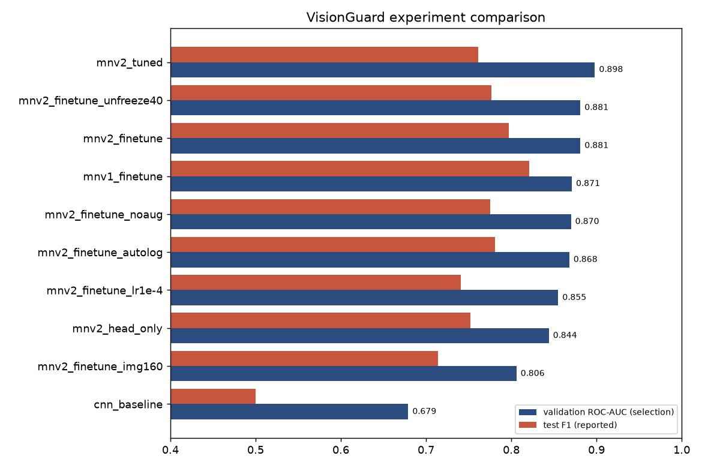

# Task 3 — Experiment Tracking with MLflow and DagsHub

**Where the runs were executed.** My training workspace (a Linux cloud machine, 2 vCPUs, no GPU) could not reach DagsHub, so every VisionGuard run was tracked in a **local MLflow store** (`mlflow.db` SQLite backend + `mlruns/` artifacts). `scripts/sync_to_dagshub.py` then replayed every run onto the DagsHub MLflow server *without retraining*: the same run names, start/end times, all parameters and tags, the **complete per-epoch metric histories (with their original steps and timestamps)** and all artifacts. Each copied run carries a `synced_from_run_id` tag pointing to the original. The toy runs (3.1/3.2) were run directly from my Mac against both stores.

## 3.1 Tool lab: MLflow locally

`labs/mlflow_toy.py` trains a tiny dense network (Flatten → Dense(64) → Dense(10)) on Fashion-MNIST for 5 epochs, twice — learning rate **0.001** and **0.01** — and for each run logs the parameters, the per-epoch `loss / accuracy / val_loss / val_accuracy` (Keras callback), an accuracy plot (artifact), tags and the model (`mlflow.tensorflow.log_model`). `mlflow ui --backend-store-uri sqlite:///mlflow_toy.db` opens the local interface, where *Compare* puts both runs side by side.

Table 3.2 — Toy runs (Fashion-MNIST, 20k training / 5k validation images, 5 epochs)

| Run | learning_rate | val_accuracy per epoch | final val_accuracy | final val_loss |
|---|---|---|---|---|
| `toy_lr_0.001` | 0.001 | 0.807 → 0.828 → 0.838 → 0.848 → 0.854 | **0.854** | **0.416** |
| `toy_lr_0.01` | 0.01 | 0.826 → 0.836 → 0.843 → 0.842 → 0.849 | 0.849 | 0.430 |

The comparison view shows the trade-off immediately: lr 0.01 learns faster in the first epochs but plateaus and wobbles (epoch 4 dips), while lr 0.001 improves smoothly and ends slightly better — the larger steps overshoot near the minimum.

Definitions in my own words:

- **Experiment** — a named folder that groups all attempts at one problem, so they can be listed and compared together (e.g. `VisionGuard`, `toy-fashion-mnist`).
- **Run** — one execution of training code: one set of choices, one result, with a unique ID, start/end time and status.
- **Parameter** — an *input* I chose before the run, logged once (learning rate, image size, backbone). Parameters are what I compare runs *by*.
- **Metric** — a numeric *output* measured by the run, possibly many times (per epoch, with a step) — loss, accuracy, AUC. Metrics are what I compare runs *on*.
- **Artifact** — any file produced by the run and stored with it: plots, the trained model, split lists, `requirements` freeze, the model summary.
- **Tag** — a free-form key/value label describing the run rather than configuring it: git commit, DVC data version, seed, author, logging mode. Tags make runs searchable and traceable.

> **Screenshot 3.3** — Local MLflow UI listing the two toy runs (lr 0.001 and 0.01) with their metrics.

> **Screenshot 3.4** — Compare view of the two runs (metric chart over epochs / parallel coordinates).

## 3.2 DagsHub setup

The DagsHub repository `ahsan24naeem/23L-0517_A2_Ops` was created with **Connect a repository → GitHub**, so it mirrors the GitHub repository's code and adds DVC storage and an MLflow server. Its tracking address is `https://dagshub.com/ahsan24naeem/23L-0517_A2_Ops.mlflow`. I created an access token (*Settings → Tokens*). Code never contains either: `visionguard/tracking.py → setup_mlflow()` loads `.env` with `python-dotenv` and MLflow itself reads `MLFLOW_TRACKING_URI`, `MLFLOW_TRACKING_USERNAME` and `MLFLOW_TRACKING_PASSWORD` from the environment. `.env` is listed in `.gitignore` and `.dockerignore`; `.env.example` documents the variable names with dummy values. Running `python labs/mlflow_toy.py --remote` repeated the toy runs on DagsHub.

> **Screenshot 3.1** — DagsHub project page (connected to GitHub).

> **Screenshot 3.2** — `git check-ignore -v .env` → `.gitignore:2:.env` and `git status` not listing `.env`.

> **Screenshot 3.5** — The two toy runs in DagsHub's MLflow UI.

## 3.3 Instrument VisionGuard training

`scripts/train.py` logs to MLflow in two ways (`--logging manual|autolog`):

**Manual logging** (all runs except one): `mlflow.log_params()` with every choice (model type, backbone, image size, batch size, both learning rates, epochs, unfreeze policy, dropout, augmentation, seed, optimiser, loss, patience, split sizes); a custom Keras callback `MLflowEpochLogger` that logs every epoch's training and validation loss/accuracy/AUC/precision/recall **and the current learning rate**, with the fine-tuning stage continuing the epoch axis of the head stage (`offset`), so both stages form one curve; final metrics (validation + test accuracy, precision, recall, F1, ROC-AUC, FPR, FNR, confusion counts, chosen threshold, best epoch, parameters, training time); tags; artifacts (3.4); and the model via `mlflow.tensorflow.log_model`.

**Autologging** (`mnv2_finetune_autolog`, same configuration as `mnv2_finetune`): `mlflow.tensorflow.autolog()` before training.

**Tags on every run:** `git_commit` (the exact code version), `git_dirty`, `dvc_data_version` (md5 of `data/raw.dvc`), `splits_md5`, `seed`, Python/TensorFlow/Keras versions, `logging_mode`, `model_family`, `author`.

Table 3.1 — What each approach captured for the same configuration (`mnv2_finetune` vs `mnv2_finetune_autolog`)

| Aspect | Manual (Keras callback + explicit calls) | `mlflow.tensorflow.autolog()` |
|--|-----|-----|
| Parameters | 18 chosen by me: model type, backbone, **image size, augmentation, unfreeze policy, dropout**, both learning rates, epochs, patience, split sizes | 39 automatic `fit()`/optimizer/callback arguments: `epochs`, `batch_size`, `opt_learning_rate`, `opt_beta_1/2`, `opt_epsilon`, EarlyStopping `monitor/patience/min_delta/restore_best_weights`… — but nothing about the data or preprocessing (I had to add img_size, augment, unfreeze by hand) |
| Per-epoch metrics | loss/accuracy/AUC/precision/recall for train and val **plus learning rate**, steps 1–30 continuous across both stages | same metrics (and `validation_*` duplicates), but **steps restart at 0 for the second `fit()`** — stage 2 is drawn on top of stage 1 instead of after it |
| Second training stage | logged correctly (`ft_lr = 1e-5` is a parameter) | **failed silently**: `Changing param values is not allowed … opt_learning_rate old 0.001 new 1e-05` — MLflow parameters are immutable, so the fine-tuning learning rate is missing |
| Final test metrics, threshold, confusion counts | yes (explicit `log_metrics`) | no — autolog only sees `fit()`; I logged them explicitly in both runs |
| Model | `mlflow.tensorflow.log_model` | yes, automatically, plus model summary and **TensorBoard event files** |
| Reproducibility tags (git commit, DVC version, seed) | yes | no — added explicitly in both runs |
| Custom artifacts (confusion matrix, ROC, splits, pip freeze) | yes | no — added explicitly |

**Conclusion.** Autologging is a quick, zero-effort safety net that records optimizer internals I would never type by hand, and it captures the model and TensorBoard logs. But it only knows about `model.fit()`: it misses everything that defines the *experiment* (data version, preprocessing, augmentation, evaluation, decision threshold) and it mishandles multi-stage training. Manual logging is more work but captures exactly what is needed to compare and reproduce runs, so it is my default; autolog is useful on top of it for single-stage experiments.

**A reproducibility observation.** The two runs use identical code, data, seed and hyper-parameters, yet reached validation AUC 0.881 vs 0.868 (test F1 0.797 vs 0.781). Seeds fix the initial weights, shuffling and augmentation, but multi-threaded CPU kernels sum floating-point numbers in a non-deterministic order, and small differences grow over 30 epochs. `tf.config.experimental.enable_op_determinism()` would remove this at a speed cost. It also shows that differences of ~0.01 AUC between runs are within noise.

> **Screenshot 3.6** — Run page of `mnv2_finetune` (manual): parameters, metric curves (train/val loss, val AUC, learning rate across both stages) and tags (git commit, DVC version, seed).

> **Screenshot 3.7** — Run page of `mnv2_finetune_autolog`: the parameters and metrics autologging produced.

## 3.4 Artifacts

Every run stores: `reports/confusion_matrix.png`, `reports/roc_curve.png`, `reports/training_curves.png` (best epoch marked), `reports/history.csv`, `reports/test_predictions.csv` and `val_predictions.csv`, `reports/model_summary.txt`, `reports/trainable_layers.json`, `reports/result.json`, **`splits/train.csv`, `val.csv`, `test.csv`**, the **package list `reports/requirements-freeze.txt`** (`pip freeze` of the training environment), the **trained Keras model `keras_model/<run>.keras`** with its threshold metadata, and the MLflow-format model `model/` (used by the registry).

> **Screenshot 3.8** — Artifacts tab of the chosen run showing these files.

## 3.5 Experiment comparison

Each run differs from the reference run `mnv2_finetune` (MobileNetV2, 224 px, head lr 1e-3 then last block at 1e-5, augmentation on) in **one** meaningful setting:

| Run | One change vs reference |
|---|---|
| `cnn_baseline` | different model family: CNN from scratch |
| `mnv2_head_only` | no fine-tuning stage (backbone fully frozen) |
| `mnv2_finetune_noaug` | augmentation off |
| `mnv2_finetune_lr1e-4` | head learning rate 1e-4 instead of 1e-3 |
| `mnv2_finetune_img160` | image size 160 instead of 224 |
| `mnv2_finetune_unfreeze40` | last 40 backbone layers unfrozen instead of the last block |
| `mnv1_finetune` | MobileNet V1 backbone instead of MobileNetV2 |
| `mnv2_tuned` | Keras Tuner's best fine-tuning settings (stage-2 lr 7.8e-5, dropout 0.3, last 10 layers) |
| `mnv2_finetune_autolog` | same config, MLflow autologging (checks logging, not the model) |

Table 3.3 — All runs, sorted by validation ROC-AUC (`scripts/compare_runs.py` → `reports/run_comparison.csv`)

| Run | Change | Best ep. | **Val AUC** | Val F1 | Thr. | Test acc. | Test prec. | Test rec. | Test F1 | Test AUC | Test FPR | Min. |
|--------|------|--|---|---|--|---|---|---|---|---|---|--|
| **mnv2_tuned** | tuner settings (2.7) | 27 | **0.898** | 0.814 | 0.71 | 0.769 | 0.885 | 0.667 | 0.761 | 0.871 | **0.106** | 8.6 |
| mnv2_finetune | reference | 27 | 0.881 | 0.816 | 0.60 | 0.796 | 0.881 | 0.728 | 0.797 | 0.868 | 0.121 | 8.5 |
| mnv2_finetune_unfreeze40 | 40 layers unfrozen | 25 | 0.881 | 0.786 | 0.76 | 0.789 | 0.931 | 0.667 | 0.777 | 0.876 | 0.061 | 8.5 |
| mnv1_finetune | MobileNet V1 backbone | 29 | 0.871 | 0.776 | 0.69 | 0.816 | 0.886 | 0.765 | 0.821 | 0.908 | 0.121 | 7.9 |
| mnv2_finetune_noaug | no augmentation | 29 | 0.870 | 0.746 | 0.73 | 0.782 | 0.902 | 0.679 | 0.775 | 0.886 | 0.091 | 7.7 |
| mnv2_finetune_autolog | autologging | 30 | 0.868 | 0.784 | 0.59 | 0.782 | 0.877 | 0.704 | 0.781 | 0.864 | 0.121 | 8.9 |
| mnv2_finetune_lr1e-4 | head lr 1e-4 | 29 | 0.855 | 0.767 | 0.65 | 0.748 | 0.855 | 0.654 | 0.741 | 0.868 | 0.136 | 7.6 |
| mnv2_head_only | no fine-tuning | 15 | 0.844 | 0.759 | 0.68 | 0.762 | 0.883 | 0.654 | 0.752 | 0.860 | 0.106 | 4.2 |
| mnv2_finetune_img160 | 160 px input | 28 | 0.806 | 0.631 | 0.77 | 0.728 | 0.847 | 0.617 | 0.714 | 0.852 | 0.136 | 5.0 |
| cnn_baseline | CNN from scratch | 11 | 0.679 | 0.475 | 0.67 | 0.592 | 0.769 | 0.370 | 0.500 | 0.735 | 0.136 | 10.1 |

{width=90%}

**What each change taught me.**

- **Pretrained vs scratch** is by far the biggest effect (+0.20 validation AUC).
- **Fine-tuning the last block** beats a frozen backbone (0.881 vs 0.844): the top features adapt from "ImageNet objects" towards "generated vs real texture".
- **Image size 160** is clearly worse (0.806): downsampling destroys fine detail, which is exactly the evidence of generation.
- **Head learning rate 1e-4** is too slow for 15 epochs (0.855).
- **Augmentation** helps validation AUC (0.881 vs 0.870) even though the no-augmentation run happens to score higher on test — another reminder that 146/147-image splits are noisy.
- **Unfreezing 40 layers** ties the reference on AUC and gives the fewest false positives on test (6.1 %), but its curves show stronger overfitting (train accuracy ≫ validation).
- **MobileNet V1** is competitive (0.871 val) and has the best *test* numbers. I did not pick it, because choosing by test results would make the test set part of model selection. ResNet50 was planned for this slot, but its ImageNet weights could not be downloaded in the training workspace (hash mismatch with the only reachable mirror), so the code supports it but the comparison uses MobileNet V1.

**Choice: `mnv2_tuned`.** My selection metric is **validation ROC-AUC**, because it measures ranking quality independently of any threshold (the threshold is chosen afterwards for the product). The champion's secondary metric is the one that matters most for the product, the **false-positive rate on real images**: at its validation-chosen threshold it flags only 7.7 % of real validation images and 10.6 % of real test images, the lowest among the top-AUC MobileNetV2 runs, while keeping 88.5 % precision. Its test AUC (0.871) confirms that the choice generalises. The top runs are within ~0.02 AUC of each other, which on 146 validation images is close to noise, so the selection is "one of several equally good MobileNetV2 configurations" rather than a decisively better model.

> **Screenshot 3.9** — DagsHub/MLflow comparison of all runs (table + chart of val AUC / test F1).

## 3.6 Model registry

`scripts/register_model.py` ranks finished runs by **validation ROC-AUC** (tie-break validation F1), creates the registered model **`visionguard`**, registers two versions from the runs' `model/` artifacts — **v1 = `cnn_baseline`** (alias `challenger`) and **v2 = the best run, `mnv2_tuned`** (alias **`champion`**) — and tags each version with its decision threshold and validation/test AUC. It then exports the champion's Keras file to `models/champion.keras` plus `champion.json` (threshold, version, run id). `scripts/predict_by_alias.py` is a separate script that loads `models:/visionguard@champion`, reads the threshold from the version's tags and classifies one image:

```text
$ python scripts/predict_by_alias.py data/raw/RealArt/1032249.jpg
tracking URI : sqlite:////home/claude/23L-0517_A2_Ops/mlflow.db
model        : models:/visionguard@champion -> version 2 (run b26390f4, mnv2_tuned)
loaded in    : 1.3s
image        : data/raw/RealArt/1032249.jpg
P(AI)=0.0247  threshold=0.71  ->  Real  (confidence 97.5%)
```

Using an alias means the serving side asks for "the champion", not "version 2": promoting a better model later is just moving the alias, with no code change.

**How the champion reaches the server (and why serving never calls DagsHub per request).** The registry is consulted **once, at deployment time**: `register_model.py` (or `dvc pull models/champion.keras`) writes the file, which is then mounted read-only into the container (Compose) or copied to the Oracle VM with `scp`. At start-up the app loads that local file into memory. Calling DagsHub per request would add hundreds of milliseconds, make the service fail whenever DagsHub is slow or rate-limits, and expose credentials on the server.

> **Screenshot 3.10** — Registry page: `visionguard` with versions 1 and 2 and the `@champion` alias.

> **Screenshot 3.11** — Terminal output of `python scripts/predict_by_alias.py <image>`.
